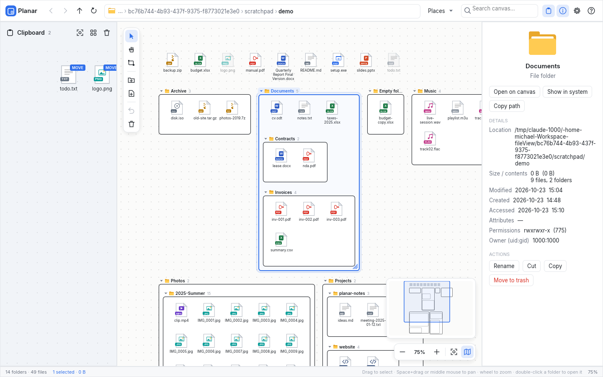

# Planar — a file explorer on an infinite canvas

Planar shows a folder tree as nested rectangles on a pannable, zoomable
canvas (think miro or an empty Paint canvas). Each folder is a rectangle with
a black border: its files sit in a desktop-style icon grid at the top, and its
sub-folders are laid out below them. A clipboard canvas on the left lets you
stage files and folders and then drop them anywhere.



It is written in **Rust** with **egui/eframe**. The same source compiles to a
single native executable for **Windows** (`planar.exe`) and **Linux**
(`planar`). The app needs no runtime, installer or web view, and the fonts are
embedded.

## Layout

| Area | What it does |
|---|---|
| **Top bar** | Back / forward / parent / refresh, a clickable breadcrumb path (click its background or press `Ctrl+L` to type a path), a folder button next to it that opens the system's folder dialog (`Ctrl+O`), *Places* (home folders and drives), canvas search, panel toggles, *View* options, help. |
| **Clipboard (left)** | A second, independent canvas. Items dragged here are *staged*; they are not changed on disk. Each item has a **MOVE** or **COPY** badge. Drag the split border to resize it. |
| **Canvas (centre)** | The root folder's contents. Floating tool palette (top left), zoom control and minimap (bottom right). |
| **Properties (right)** | Icon, type, location, size (folder sizes are computed in the background), timestamps, attributes, permissions and quick actions for the selection. |
| **Status bar** | Item counts, selection size, background jobs, context hints and zoom. |

### How the canvas is laid out
* The canvas itself is the root folder, so the root has no border.
* Files go in a grid of 88×98 tiles: a file-type icon with the name below it,
  on up to three lines. The selected file shows its full name.
* Sub-folders are shelf-packed below the files, with gaps between them. Each
  folder's name, an expand arrow and its item count sit above its upper-left
  corner.
* Folder sizes are computed bottom-up from their contents, so each folder is
  exactly as big as it needs to be. You can resize a folder by dragging its
  right or bottom edge or its corner; its files then reflow to the new width.
  Double-click the edge, or use *Reset size*, to return to the automatic size.
* File icons are drawn as vectors, in the style of the Windows Explorer icon
  set: Word, Excel, PowerPoint, PDF, image, audio, video, archive, code,
  executable, font, disk image and plain text. The type comes from the file
  extension. Symbolic links get a shortcut-arrow badge, and hidden files are
  shown faded.
* The canvas background colour (*View* options) applies to every canvas
  area: the root canvas, all folder rectangles, the clipboard canvas and the
  minimap. On dark colours, borders and names switch to light colours.
* Semantic zoom: at low zoom, labels of folders that are still reasonably
  large on screen stay readable, and tiny items are drawn as simple shapes.
* After any change, the layout is recomputed. That includes changes made by
  other programs: loaded folders are polled every 2.5 s.

## Using it

| Action | How |
|---|---|
| Select ⇄ Hand | Tap `Alt` (press and release it on its own) or click the middle mouse button. The key can be changed in *View* options → *Select / Hand toggle key*: click the button, then press any key. `Alt`, `Ctrl` and `Shift` toggle when tapped alone, other keys toggle when pressed. `V` / `H` select a tool directly |
| Pan | Hand tool, `Space` + drag, middle-mouse drag, or `Shift` + wheel |
| Zoom | Mouse wheel / pinch at the cursor, `Ctrl +` / `Ctrl −`, `Ctrl+0` to fit, `Ctrl+1` for 100 % |
| Select | Click; `Ctrl`/`Shift` + click to toggle; drag on empty space (also inside a folder) for rubber-band selection |
| Move | Drag items onto a folder (or onto empty canvas = the root) |
| Copy | Hold `Ctrl` while dropping |
| Stage | Drag items to the clipboard area, then drag them from there onto a folder |
| Cut / Copy / Paste | `Ctrl+X` / `Ctrl+C` add the selection to the clipboard area. To paste, right-click a folder and choose *Paste*, or press `Ctrl+V` to paste into the selected folder |
| Open | Double-click a file (default app) or a folder body (it becomes the root) |
| Set root | Double-click a folder, *Set as canvas root* in the context menu, the breadcrumb, type a path, or pick one with the folder button / `Ctrl+O` |
| Rename | Double-click a name, or `F2` |
| New | `Ctrl+Shift+N` folder, `Ctrl+N` text file, toolbar buttons, the context menu, or the **draw-folder tool** (`F`): drag a rectangle to create a folder of that size |
| Expand / collapse | Click the arrow next to a folder name |
| Delete | `Del` moves to the trash, `Shift+Del` deletes permanently (asks for confirmation) |
| Undo | `Ctrl+Z` (moves, renames, copies, new items) |
| Files from other apps | Drop them on a folder to copy them in, or on the clipboard area to stage them |

The context menu (right-click) works on files, on folders (click the border,
the name or the empty body), on the empty canvas, and on clipboard items.

*Auto-expand depth* (0–8) sets how many folder levels open automatically.

Settings, the root folder, the clipboard contents, custom folder sizes and
expand/collapse choices are kept between sessions.

## Building

Install Rust from <https://rustup.rs>.

### Linux (Ubuntu)
```bash
cargo build --release
./target/release/planar            # or: planar /path/to/root
```
Running needs the usual desktop libraries (OpenGL, X11 or Wayland,
libxkbcommon), which Ubuntu desktop installs by default.
`scripts/planar.desktop` is a launcher entry you can copy to
`~/.local/share/applications/`.

### Windows
On Windows:
```powershell
cargo build --release
target\release\planar.exe
```
The release build is a GUI-subsystem executable, so no console window opens.

### Cross-compiling the Windows `.exe` on Linux
```bash
rustup target add x86_64-pc-windows-gnu
# either: sudo apt install mingw-w64 && cargo build --release --target x86_64-pc-windows-gnu
# or:     cargo install cargo-zigbuild  (with zig on PATH)
#         cargo zigbuild --release --target x86_64-pc-windows-gnu
```
`scripts/build-release.sh` builds both executables into `dist/`.
`.github/workflows/build.yml` builds and tests both platforms on GitHub
Actions.

## Code map

| File | Purpose |
|---|---|
| `src/fsmodel.rs` | Breadth-first directory scan with a node budget, sorting, size/time formatting |
| `src/layout.rs` | Nested rectangle layout (file grid and shelf-packed sub-folders) |
| `src/canvas.rs` | Camera, hit testing, painting, pointer gestures (pan, marquee, drag & drop, resize, draw) |
| `src/app.rs` | App state, actions, undo, background jobs, panels, menus, shortcuts |
| `src/ops.rs` | Move / copy / rename / create / trash, run in a background thread |
| `src/icons.rs`, `src/uicons.rs` | Vector file-type icons and toolbar glyphs |
| `src/theme.rs` | Colours, fonts and egui style |
| `src/script.rs` | Scripted input for automated UI checks (`PLANAR_SCRIPT=file`) |

Run the unit tests with `cargo test`.

## Notes and limits
* Large roots (`/`, `C:\`) stay fast: about 40,000 entries are loaded
  automatically, breadth first. Deeper folders show as collapsed cards that
  load when you expand them, and folders with more than 400 files show a
  "+N more" tile.
* Folder positions are always computed automatically. The draw-folder tool
  sets a new folder's size, not its position.
* The executable's file icon on Windows is the default one. The window icon
  is set at runtime.
* The Inter font is embedded under the SIL Open Font License
  (`assets/Inter-LICENSE.txt`).
