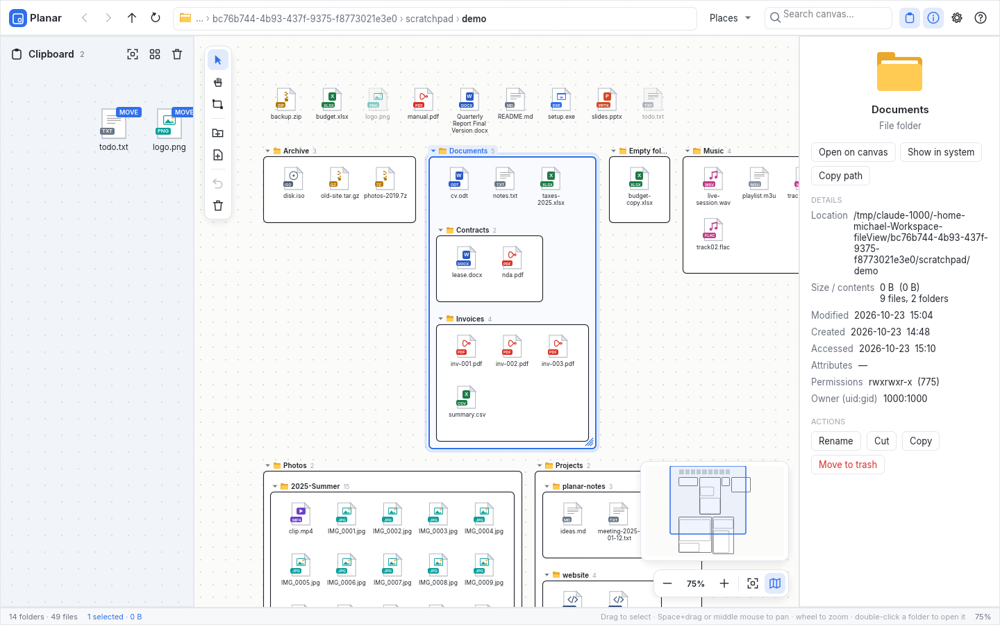

# Planar — a file explorer on an infinite canvas

Planar shows a folder tree as nested rectangles on a pannable, zoomable
canvas (think miro or an empty Paint canvas). Each folder is a rectangle with
a black border: its files sit in a desktop-style icon grid at the top, and its
sub-folders are laid out below them. A clipboard canvas on the left lets you
stage files and folders and then drop them anywhere.



It is written in **Rust** with **egui/eframe**. The same source compiles to a
single native executable for **Windows** (`planar.exe`) and **Linux**
(`planar`). The app needs no runtime or web view, and the fonts are embedded.
On Windows it ships as an installer and as a portable `.exe`.

## Installing on Windows

Download `Planar-<version>-x64-setup.exe` from the
[releases](https://github.com/MT-Blachetta/fileView/releases) and run it. It
installs Planar for the current user (no administrator rights needed), adds a
Start menu entry and an uninstaller under *Settings → Apps*. It runs on
Windows 10 and 11 (x64; ARM64 PCs run it through emulation).
`Planar-<version>-x64-portable.exe` is the same program without the
installer. `SHA256SUMS.txt` lists the checksums of both:
`Get-FileHash Planar-<version>-x64-setup.exe` must print the same value.

As long as the release is not code-signed (see [Code signing](#code-signing)),
Microsoft Defender SmartScreen shows *"Windows protected your PC"* for the
downloaded file. Click **More info → Run anyway**, or right-click the file →
*Properties* → tick **Unblock** → *OK*.

## Layout

| Area | What it does |
|---|---|
| **Top bar** | Back / forward / parent / refresh, a clickable breadcrumb path (click its background or press `Ctrl+L` to type a path), a folder button next to it that opens the system's folder dialog (`Ctrl+O`), *Places* (home folders and drives), canvas search, panel toggles, *View* options, help. |
| **Clipboard (left)** | A second, independent canvas. Items dragged here are *staged*; they are not changed on disk. Each item has a **MOVE** or **COPY** badge. Drag the split border to resize it. |
| **Canvas (centre)** | The root folder's contents. Floating tool palette (top left), zoom control and minimap (bottom right). |
| **Properties (right)** | Icon, type, location, size (folder sizes are computed in the background), timestamps, attributes, permissions and quick actions for the selection. |
| **Status bar** | Item counts, selection size, background jobs, context hints and zoom. |

### How the canvas is laid out
* The canvas itself is the root folder, so the root has no border.
* Files go in a grid of 88×98 tiles: a file-type icon with the name below it,
  on up to three lines. The selected file shows its full name.
* Sub-folders are shelf-packed below the files, with gaps between them. Each
  folder's name, an expand arrow and its item count sit above its upper-left
  corner.
* Folder sizes are computed bottom-up from their contents, so each folder is
  exactly as big as it needs to be. You can resize a folder by dragging its
  right or bottom edge or its corner; its files then reflow to the new width.
  Double-click the edge, or use *Reset size*, to return to the automatic size.
* File icons are drawn as vectors, in the style of the Windows Explorer icon
  set: Word, Excel, PowerPoint, PDF, image, audio, video, archive, code,
  executable, font, disk image and plain text. The type comes from the file
  extension. Symbolic links get a shortcut-arrow badge, and hidden files are
  shown faded.
* The canvas background colour (*View* options) applies to every canvas
  area: the root canvas, all folder rectangles, the clipboard canvas and the
  minimap. On dark colours, borders and names switch to light colours.
* Semantic zoom: at low zoom, labels of folders that are still reasonably
  large on screen stay readable, and tiny items are drawn as simple shapes.
* After any change, the layout is recomputed. That includes changes made by
  other programs: loaded folders are polled every 2.5 s.

### Rearranging items
Items start out in the sort order (by name unless changed in *View*). To
change the order, drag items and drop them between other items **of their
own folder**:

* **Files**: drop a file between two files (or before the first / after the
  last one). The other files shift to make room. Files always stay above the
  folders.
* **Folders**: drop a folder in the gap between two folders of a row (or at
  either end of a row) to place it there. Drop it in the gap above or below a
  row to put it into a new row of its own.

A blue marker shows where the items will go while you drag. Dropping onto a
folder (its body or name) still moves items into it, as before. `Ctrl+Z`
undoes a rearrangement; *Reset arrangement* in a folder's context menu (or on
the empty canvas, for the root) returns that folder to the sort order, and
*View* → *Reset arrangement of this canvas* resets every folder.

The arrangement is saved in a hidden file, `.planar-layout.json`, in the canvas
root folder. It is created on the first rearrangement and read before the
canvas is drawn. It mirrors the folder tree: for each rearranged folder it
holds the file order (`files`), the folder rows (`rows`, top to bottom, each
left to right) and the same for its sub-folders (`children`):

```json
{
  "format": "planar-layout",
  "version": 1,
  "tree": {
    "files": ["notes.txt", "a.txt"],
    "rows": [["src", "docs"], ["assets"]],
    "children": { "src": { "files": ["main.rs", "app.rs"] } }
  }
}
```

Items the file does not mention (new ones, or ones never moved) follow the
sort order after the arranged ones. Renamed items keep their place, and a
moved folder takes the arrangement of its contents along. If a folder has no
layout file of its own, opening it as the root uses its entry in the nearest
parent folder's file, and changes are written back to both, so the
arrangement looks the same from either root. The file itself never appears on
the canvas.

## Using it

| Action | How |
|---|---|
| Select ⇄ Hand | Tap `Alt` (press and release it on its own) or click the middle mouse button. The key can be changed in *View* options → *Select / Hand toggle key*: click the button, then press any key. `Alt`, `Ctrl` and `Shift` toggle when tapped alone, other keys toggle when pressed. `V` / `H` select a tool directly |
| Pan | Hand tool, `Space` + drag, middle-mouse drag, or `Shift` + wheel |
| Zoom | Mouse wheel / pinch at the cursor, `Ctrl +` / `Ctrl −`, `Ctrl+0` to fit, `Ctrl+1` for 100 % |
| Select | Click; `Ctrl`/`Shift` + click to toggle; drag on empty space (also inside a folder) for rubber-band selection |
| Move | Drag items onto a folder (or onto empty canvas = the root) |
| Rearrange | Drop items between other items of their own folder (see [Rearranging items](#rearranging-items)) |
| Copy | Hold `Ctrl` while dropping |
| Stage | Drag items to the clipboard area, then drag them from there onto a folder |
| Cut / Copy / Paste | `Ctrl+X` / `Ctrl+C` add the selection to the clipboard area. To paste, right-click a folder and choose *Paste*, or press `Ctrl+V` to paste into the selected folder |
| Open | Double-click a file (default app) or a folder body (it becomes the root) |
| Set root | Double-click a folder, *Set as canvas root* in the context menu, the breadcrumb, type a path, or pick one with the folder button / `Ctrl+O` |
| Rename | Double-click a name, or `F2` |
| New | `Ctrl+Shift+N` folder, `Ctrl+N` text file, toolbar buttons, the context menu, or the **draw-folder tool** (`F`): drag a rectangle to create a folder of that size |
| Expand / collapse | Click the arrow next to a folder name |
| Delete | `Del` moves to the trash, `Shift+Del` deletes permanently (asks for confirmation) |
| Undo | `Ctrl+Z` (moves, renames, copies, new items, rearrangements) |
| Files from other apps | Drop them on a folder to copy them in, or on the clipboard area to stage them |

The context menu (right-click) works on files, on folders (click the border,
the name or the empty body), on the empty canvas, and on clipboard items.

*Auto-expand depth* (0–8) sets how many folder levels open automatically.

Settings, the root folder, the clipboard contents, custom folder sizes and
expand/collapse choices are kept between sessions.

## Building

Install Rust from <https://rustup.rs>.

### Linux (Ubuntu)
```bash
cargo build --release
./target/release/planar            # or: planar /path/to/root
```
Running needs the usual desktop libraries (OpenGL, X11 or Wayland,
libxkbcommon), which Ubuntu desktop installs by default.
`scripts/planar.desktop` is a launcher entry you can copy to
`~/.local/share/applications/`.

`scripts/build-release.sh` copies the Linux executable into `dist/`.

### Windows
Requirements: Rust with the MSVC toolchain, the Visual Studio Build Tools
(C++ workload) and Inno Setup 6:
```powershell
winget install Rustlang.Rustup JRSoftware.InnoSetup
winget install Microsoft.VisualStudio.2022.BuildTools --override "--passive --wait --add Microsoft.VisualStudio.Workload.VCTools --includeRecommended"
```
Build and run:
```powershell
cargo build --release
target\release\planar.exe
```
To build the release files, run:
```powershell
powershell -ExecutionPolicy Bypass -File scripts\build-windows.ps1
```
It runs the tests, builds `planar.exe` and writes the installer, the portable
executable and `SHA256SUMS.txt` to `dist\`.

What makes the Windows build work smoothly:
* **MSVC toolchain** instead of a mingw/zig cross-build from Linux. Antivirus
  heuristics flag mingw-built Rust executables much more often.
* **Embedded resources** (`build.rs`): file icon, version info (product,
  company, version) and an application manifest (runs as the current user,
  per-monitor DPI aware, long paths, Windows 10/11).
* **Statically linked C runtime** (`.cargo/config.toml`), so the Visual C++
  Redistributable is not needed.
* **Renderer fallback** (`src/main.rs`): Direct3D 12 through wgpu, including
  the WARP software renderer on PCs and VMs without a GPU driver, then
  OpenGL. Vulkan is deliberately not used, because some Vulkan drivers crash
  while wgpu enumerates them. If neither works, a dialog says so instead of the window
  silently not appearing.
* The release build is a GUI-subsystem executable, so no console window
  opens.

`.github/workflows/build.yml` builds and tests both platforms on GitHub
Actions and uploads the installer. Pushing a tag such as `v0.2.0` also
publishes a GitHub Release with the installer, the portable `.exe`, the
checksums and the Linux binary.

### Code signing
Only a code-signing certificate from a trusted certificate authority gets rid
of SmartScreen's *"unknown publisher"* warning. With a certificate, the build
script signs `planar.exe`, the installer and the uninstaller, and adds an
RFC 3161 timestamp so the signatures stay valid after the certificate expires:
```powershell
# certificate in the Windows certificate store (also USB tokens, Certum SimplySign)
scripts\build-windows.ps1 -CertThumbprint <SHA-1 thumbprint>
# or a .pfx file
scripts\build-windows.ps1 -PfxFile cert.pfx -PfxPassword <password>
```
The same values can be given as the environment variables
`PLANAR_SIGN_THUMBPRINT`, `PLANAR_SIGN_PFX` and `PLANAR_SIGN_PFX_PASSWORD`.
signtool comes with the Windows SDK, which the Build Tools install.

Ways to get a certificate:
* **Certum Open Source Code Signing**: inexpensive, for individual open-source
  developers. The certificate lives in the cloud (SimplySign) and shows up in
  the Windows certificate store, so `-CertThumbprint` works.
* **SignPath Foundation**: free signing for qualifying open-source projects;
  it signs inside GitHub Actions.
* **Azure Trusted Signing**: Microsoft's signing service with a monthly fee;
  check its current eligibility rules for individuals and companies.
* A regular OV code-signing certificate from any CA (delivered on a hardware
  token).

A new certificate still has to build up SmartScreen reputation through
downloads, so the warning can appear for a short while after the first signed
release. If Microsoft Defender itself reports the file as a threat, submit it
as a false positive at <https://www.microsoft.com/wdsi/filesubmission>.

## Code map

| File | Purpose |
|---|---|
| `src/fsmodel.rs` | Breadth-first directory scan with a node budget, sorting, size/time formatting |
| `src/layout.rs` | Nested rectangle layout (file grid and shelf-packed sub-folders) |
| `src/arrange.rs` | Custom item order (drag to rearrange) and its hidden `.planar-layout.json` file |
| `src/canvas.rs` | Camera, hit testing, painting, pointer gestures (pan, marquee, drag & drop, resize, draw) |
| `src/app.rs` | App state, actions, undo, background jobs, panels, menus, shortcuts |
| `src/ops.rs` | Move / copy / rename / create / trash, run in a background thread |
| `src/icons.rs`, `src/uicons.rs` | Vector file-type icons and toolbar glyphs |
| `src/theme.rs` | Colours, fonts and egui style |
| `src/script.rs` | Scripted input for automated UI checks (`PLANAR_SCRIPT=file`) |

Run the unit tests with `cargo test`.

## Notes and limits
* Large roots (`/`, `C:\`) stay fast: about 40,000 entries are loaded
  automatically, breadth first. Deeper folders show as collapsed cards that
  load when you expand them, and folders with more than 400 files show a
  "+N more" tile.
* Folder positions are computed automatically from the order and rows
  (see *Rearranging items*); there is no free placement. The draw-folder tool
  sets a new folder's size, not its position.
* Rearranging needs write access to the canvas root: in read-only folders the
  new order lasts only until the app closes.
* The Windows file icon (`assets/planar.ico`) is generated from the same
  shapes as the window icon by `scripts/make-icon.py`.
* The Inter font is embedded under the SIL Open Font License
  (`assets/Inter-LICENSE.txt`).
